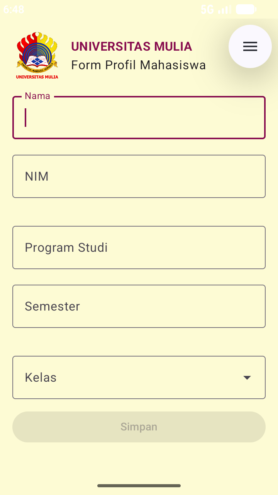
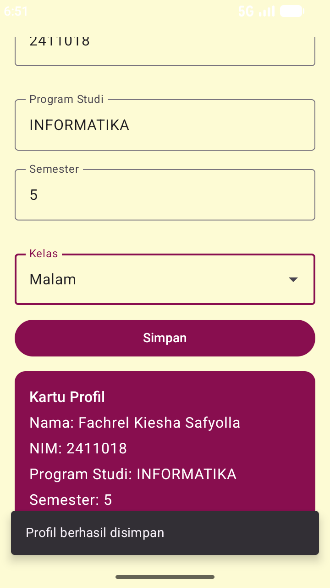

# Form Profil Mahasiswa
Aplikasi Jetpack Compose untuk menginput Nama, NIM, dan Program Studi.
Menerapkan State (remember + mutableStateOf), Event (onValueChange, onClick),
validasi input, Snackbar, dan Recomposition.

## Cara menjalankan
Buka di Android Studio, tunggu gradle selesai lalu Run di emulator atau perangkat.

## Screenshot

